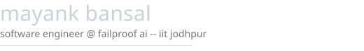
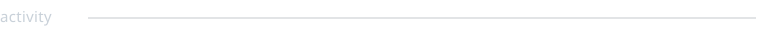
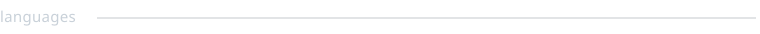

<!-- portrait.svg goes here once scripts/generate_portrait.py has run on a photo -->

 

> Everything below is generated inside this repository by a scheduled
> action. The whole page makes zero third-party requests -- no badge
> services, no stats widgets, nothing that can rate-limit or go dark.

Software engineer working across full-stack web and mobile, with a growing 
focus on machine learning and generative AI. Currently building at Failproof 
AI; before that, computer science at IIT Jodhpur. This page is generated by 
the repository you're looking at -- no third-party badges, no widgets that 
can go dark.

<samp>
languages&nbsp;&nbsp;&nbsp;c, c++, python, javascript, typescript, java, kotlin, dart 
frontend&nbsp;&nbsp;&nbsp;&nbsp;react, next.js, react native, tailwindcss, vite 
backend&nbsp;&nbsp;&nbsp;&nbsp;&nbsp;node, express, fastapi, flask, django, socket.io 
data / ml&nbsp;&nbsp;&nbsp;pytorch, tensorflow, scikit-learn, pandas, numpy, opencv 
infra&nbsp;&nbsp;&nbsp;&nbsp;&nbsp;&nbsp;&nbsp;aws, gcp, cloudflare, vercel, render, firebase, docker 
databases&nbsp;&nbsp;&nbsp;postgres, mysql, mongodb, sqlite, supabase
</samp>

<samp>
site&nbsp;&nbsp;&nbsp;&nbsp;&nbsp;&nbsp;&nbsp;https://www.mayankbansal.space 
instagram&nbsp;&nbsp;&nbsp;https://instagram.com/mayankbansal0915
</samp>

how this page works

 

Four SVGs (<samp>stats.svg</samp>, <samp>streak.svg</samp>,
<samp>langs.svg</samp>, <samp>year.svg</samp>) are redrawn every night by
<a href=".github/workflows/refresh-stats.yml">a GitHub Actions
workflow</a> that queries this account's own GraphQL API and commits only
when a number actually changed. It uses the repository's built-in
<samp>GITHUB_TOKEN</samp> -- no personal access token, no dependencies
beyond the Python standard library.

The contribution window is pinned to whole UTC days and the language
stats only count public repositories, so the output is the same
regardless of who or what triggers the run.

The portrait at the top runs once, by hand, from
<samp>scripts/generate_portrait.py</samp>: background removal, a
bilateral filter, local contrast (CLAHE), a darkening curve, then a
13-character ramp -- typed on load via an SVG wipe animation, not
looping.

Every graphic embeds its own subset of JetBrains Mono (SIL OFL 1.1) as a
base64 <samp>@font-face</samp>, since an <samp>&lt;img&gt;</samp>-embedded
SVG can't fetch an external font.

portrait pipeline credit: the ASCII Portrait README Guide &middot; typeface: JetBrains Mono, SIL OFL 1.1
